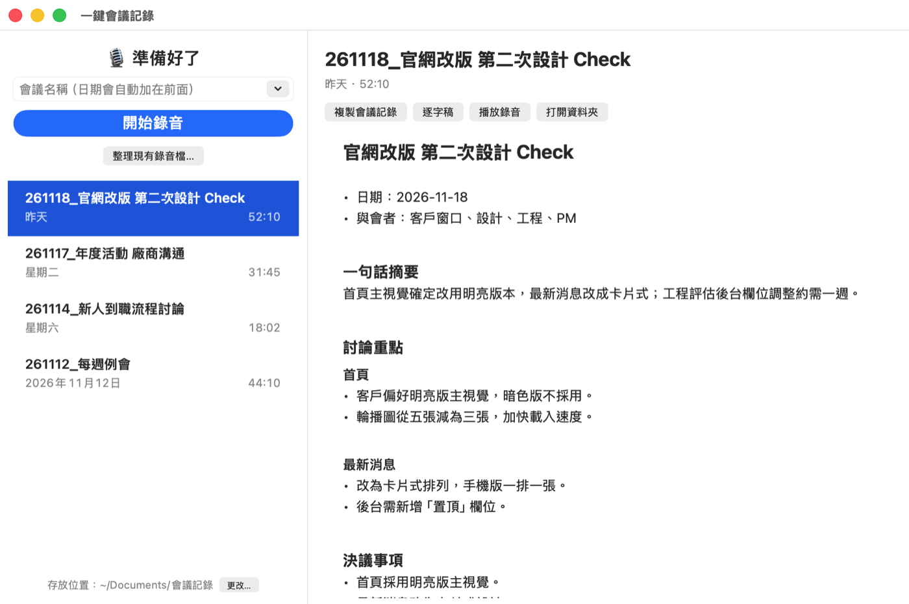

# 🎙 一鍵會議記錄

按一下開始錄音，開完會自動產生**逐字稿＋會議記錄**（摘要、討論重點、決議、待辦事項），可以直接複製使用。

- **線上、實體會議都能錄**：同時錄你的麥克風和電腦播出的聲音，Google Meet、Zoom、Teams 對方的聲音都錄得到（戴耳機也可以）
- **會議列表**：自動用「日期_會議名稱」命名，打過的名稱會自動補完
- **固定格式的會議記錄**：待辦事項會整理成勾選清單（誰、做什麼、什麼時候），格式可以自己改
- **不會錄到音樂**：Spotify、Apple Music 等音樂 App 的聲音會自動排除
- **自動更新**：有新版時 App 會提示，按一下就更新

## ⬇️ 下載

**[下載最新版（MeetingRecorder.zip）](https://github.com/o3obbb/meeting-recorder/releases/latest/download/MeetingRecorder.zip)**

| 需要 | 說明 |
|---|---|
| Mac | M 系列晶片（M1 以後） |
| macOS | 26 以上 |
| Claude（選用） | 有 [Claude Code](https://claude.com/product/claude-code) 並登入（需要 Claude Pro 以上的付費方案），才會自動整理成會議記錄；沒有的話只產出逐字稿。App 裡可以一鍵安裝、登入 |

## 安裝

1. 解壓縮，把「一鍵會議記錄.app」拖進「應用程式」資料夾
2. 打開它。macOS 會說無法確認開發者 → 按「完成」
   （這個 App 是個人製作，沒有向 Apple 付費認證，所以第一次會被擋）
3. 到「系統設定 → 隱私權與安全性」，拉到最下面，按「一鍵會議記錄」旁邊的「強制打開」
4. 照著跳出來的「開始前檢查」，把每一項打勾（麥克風、螢幕與系統錄音、Claude 登入）

## 🧰 小功能

**上方選單「一鍵會議記錄」**

| 選單 | 用途 |
|---|---|
| 檢查更新… | 手動檢查有沒有新版（平常會自動檢查） |
| 開始前檢查… | 檢查麥克風、錄音權限、語音辨識、Claude 登入、通知，有問題旁邊有按鈕直接處理 |
| 編輯詞彙表… | 加入常被聽錯的人名、公司名、專有名詞，一行一個，辨識和整理時都會參考 |
| 編輯會議記錄格式… | 調整會議記錄的段落和規則，例如想多一段「預算」、不要「下次會議」 |
| 語音辨識引擎 | Apple（內建、免下載）或 Whisper（比較準，第一次要下載 550MB） |

**視窗裡**

- **改招呼語**：按「🎙 準備好了」旁邊的 ✏️（或直接點那行字），可以改成任何你想看到的句子，按 Enter 存起來
- **整理現有錄音檔…**：手機錄音、語音備忘錄、會議錄影都可以丟進來整理，日期會用錄音檔的日期
- **編輯會議記錄**：右邊按「編輯」可以直接修改內容，改完按「完成」或 ⌘S 存起來；切到別場會議也會自動存
- **右鍵選單**：在列表上按右鍵，可以重新命名（日期會自動保留）、在 Finder 中顯示、移到垃圾桶
- **更改存放位置**：視窗左下角「更改…」，例如改存到 iCloud 雲碟
- **錄音中按 ⌘Q**：會先問你要不要結束錄音並整理，不會不小心把錄音弄丟

## 🔒 隱私

- **錄音檔和語音辨識都在你的電腦上**，錄音不會上傳到任何地方
- 如果有登入 Claude，**逐字稿文字**會用你自己的 Claude 帳號送去整理成會議記錄（跟你在 Claude 上貼文字一樣）
- 不想把逐字稿送出去？不登入 Claude 就好，App 只會產出逐字稿
- 錄別人說話前，記得先告知與會者

## 常見問題

**打開時說「無法確認開發者」、打不開？**
照上面安裝步驟 3，到「系統設定 → 隱私權與安全性」按「強制打開」。只有第一次需要。

**錄不到線上會議對方的聲音？**
上方選單「一鍵會議記錄 → 開始前檢查…」，確認「螢幕與系統錄音」有打勾（App 只錄聲音，不錄畫面）。允許後要重開 App。

**逐字稿很多錯字？**
- 常被聽錯的人名、專有名詞：上方選單「一鍵會議記錄 → 編輯詞彙表…」加進去
- 可以在「一鍵會議記錄 → 語音辨識引擎」改用 Whisper（比較準，但第一次要下載 550MB）
- 線上會議戴耳機效果最好

**只產出逐字稿，沒有會議記錄？**
代表 Claude 沒有安裝或沒登入。上方選單「開始前檢查…」按「一鍵登入」，登入後在那場會議按「✨ 用 Claude 整理這場」就能補整理。

**會議記錄存在哪裡？**
預設在「文件 / 會議記錄」，每場一個資料夾（會議記錄、逐字稿、錄音檔）。可以在 App 視窗左下角更改。

---

個人製作的小工具，歡迎使用，但不提供任何保證。
